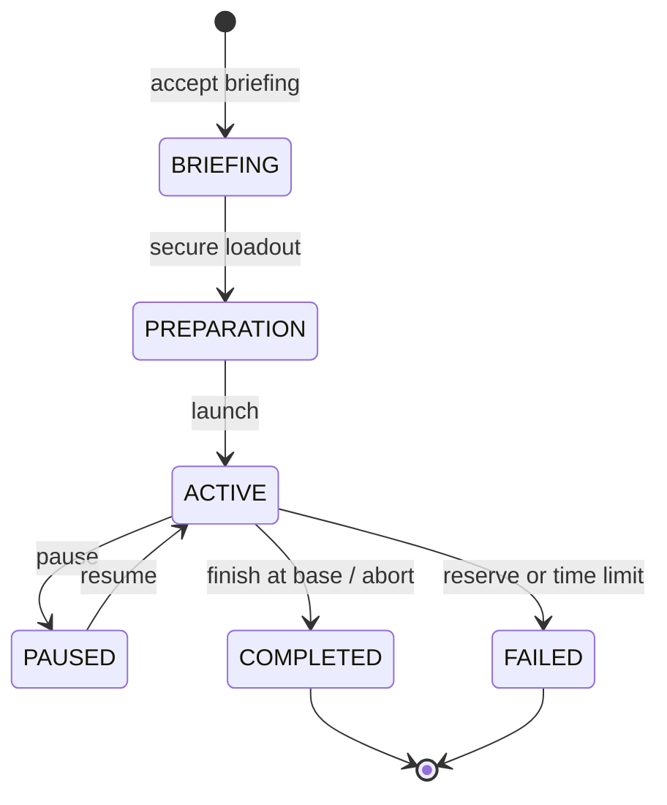

# Gameplay

## First mission

1. Select **Start your mission** to open the briefing directly, then choose a fictional callsign: Pathfinder, Explorer, or Voyager. Alternatively, open Missions to choose Mission 01 and meet Nova, ORBIT, and Scout first.
2. Read the briefing. Accepting it creates an anonymous server session in `BRIEFING`.
3. Select up to two different equipment items. Securing the loadout moves to `PREPARATION`.
4. Begin the lunar landing from mission control. This moves to `ACTIVE` at Artemis Base.
5. Inspect the habitat. This reveals the broken solar-array connector.
6. Choose a power plan: travel to the array and repair it, or use battery power. You may repair later even after choosing battery power.
7. Choose sites from the map or destination list, then select Travel to site. Arrow keys/WASD work when the map has focus; touch movement buttons are also available. Rocks are impassable; routed trips follow a shortest passable path.
8. Collect a ridge rock sample and/or a crater-edge soil sample. Samples are fictional discoveries, not proof of ice.
9. A scripted particle event begins at mission minute `30 + seed % 7` and ends 14 minutes later. Shielding halves risk accumulation. Habitat and field shelter protect time spent there; moving back to them still takes supplies. Ordinary crater shadow is not protective shielding.
10. Travel back to Artemis Base. Complete mission to finish and open the debrief and learning report.

Time moves only on accepted actions. Reading, map selection, page navigation, and real-time waiting consume nothing. The Pause action persists `PAUSED`; Resume returns to `ACTIVE` without changing resources. Every accepted command is saved immediately. Reload the same browser to resume the same mission from its server record.

## Equipment

| Item | Persistent effect |
| --- | --- |
| Extra oxygen | Capacity and starting reserve increase from 100 to 125 educational units |
| Repair toolkit | Array repair falls from 9 minutes / 12 Wh to 6 minutes / 8 Wh |
| Lunar rover | Energy capacity increases from 100 to 140 Wh; travel uses 1.5 Wh/tile rather than 0.7 |
| Radiation shielding | Halves outside risk contributions |

The solar array adds 1.2 Wh per subsequent mission minute, capped at capacity. It does not generate oxygen. Energy is a shared mission budget, not a detailed wiring or remote charging model.

## Three workable strategies

**Repair and explore:** choose extra oxygen and repair tools. Inspect, visit the solar array, repair, collect the ridge sample, collect the crater sample, return, complete. This reaches the excellent outcome with a safety reserve.

**Battery expedition:** choose extra oxygen and the rover. Inspect, select battery power, collect both samples, return, complete. The array stays broken and there is no generation; the larger starting energy reserve supports the excursion.

**Short safe sortie:** choose shielding and repair tools (or another pair). Inspect, select battery power, visit only the ridge, collect one sample, return, complete. This gives a safe return with reduced science and uses fewer supplies.

## Outcomes

| Outcome | Conditions |
| --- | --- |
| Excellent | Finish at inspected habitat with 2 samples, repaired array, O₂ ≥20, energy ≥20, risk <70 |
| Science complete | Finish at inspected habitat with 2 samples, missing an excellent condition |
| Safe return | Finish at inspected habitat with 1 sample |
| Partial completion | Finish at inspected habitat with no samples |
| Mission abort | Explicitly confirm fictional emergency recovery during an active sortie |
| Mission failure | Any reserve reaches zero, risk reaches 100, or elapsed mission time reaches 100 minutes |

A failed journey stops on the tile where the reserve runs out, not at its planned endpoint. A long non-travel activity resolves its full action duration and ends unsuccessfully when a limit is crossed. Terminal sessions reject further commands. The replay flow starts a new session; old server records remain until managed by the operator.

## Learning

Every action produces a log with its title, time, resource deltas, and explanation. The journal shows the sequence in reverse chronological order. Completed and failed missions receive a saved report with outcome, supplies, sample count, achievement labels, lessons, and a suggestion for another strategy. Journal export omits the private session capability.

During exploration, Nova or ORBIT gives a short contextual message. **Tell me why** opens the full explanation. The field notebook's **Check in with Scout** button explains the actual equipped-rover or walking costs; clicking the parked rover in the scene opens the same information. These conversations do not consume resources. The simulated event alert, reserves, and next objective remain visible alongside the scene.

## State machine

`NOT_STARTED` is the browser's no-session condition, not a database session. The stored lifecycle is:

